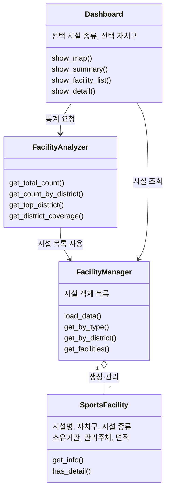

# 서울체육맵: 서울 공공체육시설 탐색 대시보드

서울시 공공체육시설을 **시설 종류별·자치구별 분포**로 비교하고, 원하는 지역의 체육시설 정보를 단계적으로 탐색할 수 있는 Streamlit 대시보드입니다.

> 객체지향프로그래밍 팀 프로젝트

---

## 1. 프로젝트 개요

- 사용자가 **시설 종류**를 선택하면 서울시 25개 자치구별 시설 수를 **지도와 주요 통계 카드**로 보여줍니다.
- 지도에서 **자치구를 선택**하면 해당 지역의 **시설 목록**과 **개별 시설 상세정보**를 확인할 수 있습니다.
- 간이운동장은 상세 자료가 일부만 제공되므로 **자치구별 집계에는 포함**하고, **상세 탐색에서는 제외**합니다.

---

## 2. 실행 방법

### 요구 사항
- Python 3.9 이상

### 설치 및 실행

```bash
# 1. 레포지토리 클론
git clone https://github.com/kw-oop-team-project/oop-team-project.git
cd oop-team-project

# 2. 가상환경 생성 및 활성화
python -m venv venv
venv\Scripts\activate          # Windows
# source venv/bin/activate     # macOS / Linux

# 3. 라이브러리 설치
pip install -r requirements.txt

# 4. 실행
streamlit run app.py
```

실행 후 브라우저에서 `http://localhost:8501`이 자동으로 열립니다.

### 배포 주소
- Dashboard URL: (배포 후 추가 예정)

---

## 3. 사용 데이터

| 구분 | 데이터명 | 출처 | 용도 |
|---|---|---|---|
| 기본 데이터 | 서울시 공공체육시설 현황 | 서울 열린데이터광장 | 시설 정보, 종류별·자치구별 집계 |
| 추가 데이터 | 서울시 자치구 경계 (GeoJSON) | 행정동 경계 데이터를 자치구 단위로 가공 | 자치구별 분포 지도 |

- 자치구 경계는 행정동 경계 데이터를 자치구(`sggnm`) 기준으로 병합(dissolve)하여 생성했습니다. 변환 코드는 `scripts/make_districts.py`에 있습니다.
- 각 자치구 이름은 `properties.name`에 `"강남구"` 형식으로 저장되어 있습니다.

---

## 4. 클래스 설계

| 클래스 | 주요 책임 | 주요 속성 | 주요 메서드 |
|---|---|---|---|
| `SportsFacility` | 개별 공공체육시설 정보를 하나의 객체로 표현 | 시설명, 자치구, 시설 종류, 소유기관, 관리주체, 면적 | `get_info()`, `has_detail()` |
| `FacilityManager` | 원본 데이터를 불러와 시설 객체를 생성·저장하고 조건에 맞게 검색·필터링 | 시설 객체 목록, 시설 종류 목록, 자치구 목록 | `load_data()`, `get_by_type()`, `get_by_district()`, `get_facilities()` |
| `FacilityAnalyzer` | 시설 객체를 이용해 서울 전체 및 자치구별 통계 계산 | 시설 객체 목록, 자치구별 집계 결과 | `get_total_count()`, `get_count_by_district()`, `get_top_district()`, `get_district_coverage()` |
| `Dashboard` | 분석 결과를 지도·통계·목록·상세정보로 시각화하고 사용자 입력 처리 | 선택 시설 종류, 선택 자치구, 화면 상태 | `show_map()`, `show_summary()`, `show_facility_list()`, `show_detail()` |

### 클래스 관계도



### 객체지향 설계 포인트
- **책임 분리**: 데이터 표현(`SportsFacility`), 관리·검색(`FacilityManager`), 통계 계산(`FacilityAnalyzer`), 화면 표시(`Dashboard`)를 각각 다른 클래스가 맡습니다. Dashboard는 직접 계산하지 않고 다른 객체의 메서드를 호출해 결과만 받습니다.
- **캡슐화**: 각 클래스는 내부 데이터 처리 방식을 감추고, 메서드를 통해서만 정보를 제공합니다.
- **구성(Composition)**: Dashboard가 Manager와 Analyzer 객체를 가지고 이를 조합해 화면을 구성합니다.

---

## 5. 객체 간 상호작용 및 처리 흐름

| 단계 | 입력 / 상태 | 수행 객체 | 상호작용 | 결과 |
|---|---|---|---|---|
| 1 | 원본 데이터 | `FacilityManager` | `load_data()`로 데이터 읽기 | 프로그램에서 사용할 데이터 확보 |
| 2 | 시설별 데이터 | `FacilityManager` → `SportsFacility` | 시설마다 `SportsFacility` 객체 생성 후 목록에 저장 | 시설 객체 목록 생성 |
| 3 | 시설 종류 선택 | `Dashboard` → `FacilityAnalyzer` | 선택한 종류를 전달해 자치구별 시설 수, 전체 수, 최다 보유 자치구, 보유 자치구 수 계산 | 선택 시설 기준 통계 |
| 4 | 계산된 통계 | `FacilityAnalyzer` → `Dashboard` | `show_map()`, `show_summary()`로 시각화 | 서울 지도와 통계 카드 표시 |
| 5 | 지도에서 자치구 선택 | `Dashboard` → `FacilityManager` | 자치구와 시설 종류를 전달해 `get_facilities()` 호출 | 해당 자치구의 시설 목록 |
| 6 | 목록에서 시설 선택 | `Dashboard` → `SportsFacility` | `get_info()`로 상세정보 조회 | 시설 상세정보 표시 |

---

## 6. 대시보드 기능

### 메인 화면 (시설 종류별 현황)
- **시설 종류 선택**: 드롭다운에서 시설 종류를 선택합니다.
- **자치구별 분포 지도**: 서울시 25개 자치구를 시설 수에 따라 색으로 구분해 표시합니다. 자치구에 마우스를 올리면 자치구명과 시설 수가 나타납니다.
- **핵심 통계 카드**
  - 서울 전체 시설 수
  - 최다 보유 자치구
  - 시설 보유 자치구 수 (○○ / 25)
- 시설 종류를 바꾸면 지도와 통계 카드가 함께 갱신됩니다.

### 상세 탐색 화면
- **자치구 선택 → 시설 목록**: 지도에서 선택한 자치구의 시설 목록을 보여줍니다.
- **시설 상세정보**: 목록에서 시설을 선택하면 시설명, 소유기관, 관리주체, 면적 등을 표시합니다.
- 간이운동장은 상세 탐색 대상에서 제외됩니다.

---

## 7. 폴더 구조

```
oop-team-project/
├── app.py                  # Streamlit 실행 파일
├── requirements.txt
├── data/                   # 시설 데이터, 자치구 경계 GeoJSON
├── src/                    # 클래스 코드
│   ├── sports_facility.py
│   ├── facility_manager.py
│   ├── facility_analyzer.py
│   └── views/              # Dashboard 화면 (메인 / 상세)
├── scripts/                # 데이터 전처리 코드
└── docs/                   # 보고서, 스크린샷
```

---

## 8. 팀원 및 역할

| 이름 | GitHub | 담당 |
|---|---|---|
| 백다현 (팀장) | [@bdh041229](https://github.com/bdh041229) | 데이터 전처리 / `SportsFacility` |
| 박준혁 | [@junh06](https://github.com/junh06) | 시설 관리 / `FacilityManager` |
| 강지원 | [@kjw817](https://github.com/kjw817) | 통계 분석 / `FacilityAnalyzer` |
| 전종석 | [@yoshep03](https://github.com/yoshep03) | 메인 대시보드 / `Dashboard` (지도, 통계 카드) |
| 이정기 | [@lig10250](https://github.com/lig10250) | 상세 탐색 및 통합 / `Dashboard` (목록, 상세정보) |
