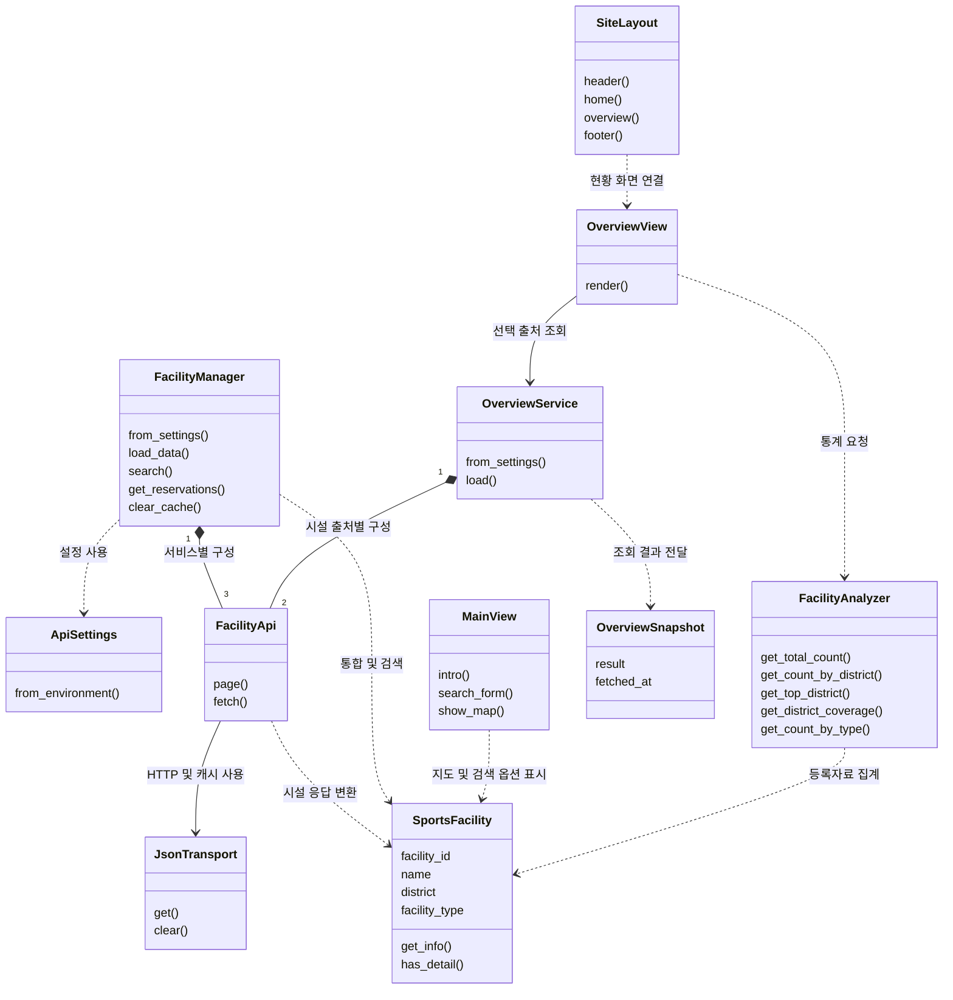

# 서울체육맵: 서울 공공체육시설 탐색 대시보드

서울시와 국민체육진흥공단의 공공 API를 함께 조회하여 **서울의 공공체육시설을 자치구·시설명·종목으로 찾는 Streamlit 사이트**입니다.
지도와 목록에서 시설을 선택하고, 주소·운영시간·연락처·이용료 및 공식 예약 일정을 확인할 수 있습니다.
별도의 **체육시설 현황** 탭에서는 제공기관의 등록자료를 기준으로 자치구별 분포와 시설 종류를 비교합니다.

> 객체지향프로그래밍 팀 프로젝트

---

## 1. 프로젝트 개요

- **홈**에서 체육 이미지와 서비스 소개를 확인하고 원하는 메뉴로 이동합니다.
- **체육시설 찾기**에서 서울 지도 위의 시설을 살펴보고 자치구·시설명·종목으로 검색합니다.
- 지도 표시나 시설 목록을 선택하면 해당 시설의 상세정보와 예약 안내를 확인할 수 있습니다.
- **체육시설 현황**은 출처·시설 종류·간이운동장 포함 여부에 따른 통계 카드, 자치구 분포 지도, 비교 그래프와 집계표를 제공합니다. 시설 검색·목록·상세·예약 기능은 넣지 않습니다.

시설 데이터는 API로 조회하며 CSV 파일을 사용하지 않습니다. 현황 지도에만 별도의 자치구 경계 GeoJSON을 사용합니다.
기본정보만 제공되는 시설도 검색 결과에서 숨기지 않으며, API에 없는 값은 `정보 없음`으로 표시합니다.

---

## 2. 실행 방법

### 요구 사항

- Python 3.11 이상 권장
- 시설 및 예약 API 인증키와 각 서비스에 대한 이용 승인

### 설치 및 실행

```powershell
# 1. 저장소 클론
git clone https://github.com/kw-oop-team-project/oop-team-project.git
cd oop-team-project

# 2. 가상환경 생성 및 활성화 (Windows PowerShell)
python -m venv .venv
.venv\Scripts\Activate.ps1

# 3. 라이브러리 설치
python -m pip install -r requirements.txt

# 4. 아래 인증 설정을 완료한 뒤 실행
python -m streamlit run app.py
```

macOS / Linux에서는 가상환경을 `source .venv/bin/activate`로 활성화합니다.
실행 후 브라우저에서 `http://localhost:8501`에 접속합니다.

### API 인증 설정

프로젝트 루트의 `.streamlit/secrets.toml`에 다음 형식으로 실제 발급받은 키를 설정합니다.
빈 설정 예시는 [secrets.example.toml](.streamlit/secrets.example.toml)에 있습니다.

```toml
# 서울시 공공체육시설 정보 (facilities)
SEOUL_OPEN_API_KEY = "발급받은 서울시 시설 API 키"

# 국민체육진흥공단 전국체육시설 정보
DATA_GO_KR_SERVICE_KEY = "발급받은 공공데이터포털 키"

# 서울시 공공서비스예약 (별도 키가 없다면 빈 문자열 또는 생략)
SEOUL_RESERVATION_API_KEY = ""
```

- 같은 이름의 환경변수로도 설정할 수 있으며, 비어 있지 않은 환경변수가 secrets보다 우선합니다.
- `SEOUL_RESERVATION_API_KEY`가 비어 있거나 생략되면 예약 API도 `SEOUL_OPEN_API_KEY`를 사용합니다. 별도 예약 키가 있으면 그 키를 우선합니다.
- 공공데이터포털 키는 일반 인증키(Decoding)를 권장합니다. Encoding 형태도 한 번 디코딩하여 처리합니다.
- `.env` 파일은 자동으로 읽지 않습니다.
- 실제 키가 들어 있는 `secrets.toml`과 `.env`는 Git에서 제외합니다. 키를 소스·테스트 데이터·로그에 기록하지 않습니다.

### 배포 상태

공개 사이트: **[서울체육맵](https://seoul-sports-map.streamlit.app/)**

Streamlit Community Cloud에서 운영합니다. `main`에 반영한 변경사항은 연결된 배포의 갱신 대상입니다.
변경사항을 푸시한 뒤 공개 사이트에서 해당 기능이 반영됐는지 확인합니다.
배포 설정은 저장소 `kw-oop-team-project/oop-team-project`, 브랜치 `main`, 실행 파일 `app.py`를 사용합니다.
배포 환경의 Secrets에도 위와 같은 이름으로 인증키를 설정합니다.

---

## 3. 사용 데이터와 처리 정책

### 연동 API

| API | 공식 명세 | 용도 및 조회 방식 |
|---|---|---|
| 서울시 공공체육시설 정보 `facilities` | [OA-21779](https://data.seoul.go.kr/dataList/OA-21779/A/1/datasetView.do) | 시작/끝 인덱스로 페이지 조회. `BK_CD_NAME=공공체육시설`을 선별하고 `FT_KIND_NAME`을 종목으로 사용 |
| 국민체육진흥공단 전국체육시설 정보 | [15113986](https://www.data.go.kr/data/15113986/openapi.do) | `SRVC_API_SFMS_FACI/TODZ_API_SFMS_FACI`에 `cp_nm=서울특별시`, `faci_gb_nm=공공`, `pageNo`, `numOfRows`, `resultType=JSON` 전달. 응답에서도 서울·공공 여부를 재검사하여 서울시 결과 보완 |
| 서울시 체육시설 공공서비스예약 정보 `ListPublicReservationSport` | [OA-2266](https://data.seoul.go.kr/dataList/OA-2266/A/1/datasetView.do) | 선택 시설에 연결되는 예약의 접수 상태·접수/이용 기간·요금·공식 예약 링크 표시 |

서울시 API는 `http://openapi.seoul.go.kr:8088` 게이트웨이를 사용합니다.
전국체육시설 API는 HTTPS를 사용하며 TLS 인증서 검증을 해제하지 않습니다.

### 시설 찾기의 통합과 지도 표시

- 두 시설 API의 결과를 합집합으로 표시하므로 서울시 API에 없는 전국 API 시설도 검색할 수 있습니다.
- 자치구·정규화한 시설명·주소·종목이 일치하고 상세주소가 충돌하지 않으며, 통합 후보가 하나일 때만 같은 시설로 합칩니다.
- 공백·문장부호·서울시 명칭과 수영/수영장 같은 종목 표기를 정규화합니다. 이름 유사도나 도로명/지번 주소의 추측 변환으로 합치지 않습니다.
- 주소가 없거나 일치 여부가 모호하면 독립 결과로 표시합니다. 검색 결과 수는 서울 전체 시설의 확정 집계가 아닙니다.
- 서울시 정보를 우선하고 누락된 값만 전국 API로 보완합니다. 통합 시설은 상세 화면에서 제공기관별 원본 정보를 비교할 수 있습니다.
- 서울시 시설 API에는 위경도가 없어 전국 API에서 제공되거나 통합 과정에서 보완된 유효 좌표만 지도에 표시합니다.
- 좌표가 없는 시설도 검색 목록에 포함하며, 상세 화면의 `주소로 지도 검색` 링크를 제공합니다.
- 운영시간·이용료 등 제공되지 않은 값은 `정보 없음`으로 표시하고 홈페이지와 연락처를 안내합니다.

### 현황 탭의 집계 기준

- 기본 출처는 국민체육진흥공단의 서울 공공시설 자료이며 서울시 API로 전환할 수 있습니다. **두 기관의 자료를 합산하지 않습니다.**
- 집계 단위는 선택한 출처의 시설 ID 기준 등록 항목입니다. 동일 ID의 반복 응답만 제외하고, 이름·주소가 같아도 다른 ID는 별도 항목으로 셉니다.
- 등록자료 수는 실제 고유 건물·시설·코트 수나 현재 이용 가능한 시설 수를 확정한 값이 아닙니다.
- 간이운동장은 기본 포함이며 제외할 수 있습니다. 시설 종류는 제공기관의 분류를 사용하고 검색용 종목 별칭으로 임의 통합하지 않습니다.
- 모든 통계에 같은 조건을 적용합니다. 25개 구를 모두 표시하며 0건인 구도 포함하고, 최다 자치구가 동률이면 모두 안내합니다.
- 종류별·자치구별 비중의 분모는 현재 선택 조건의 등록 항목 합계입니다. 시설 좌표가 없는 항목도 집계합니다.
- 조회 완료 시각은 API 응답을 확인한 시각이며 원본 갱신일이나 자료의 기준 연도가 아닙니다.
- 지도 경계는 JUSO 2015 기반의 통계 표시용 자료입니다. [원본·라이선스 안내](assets/README.md)를 참고하세요.

### 예약 연결

- 자치구·종목과 장소명·서비스명을 대조하여 전체 시설 목록에서 연결 후보가 하나인 예약만 표시합니다.
- 장소명이 같은 다른 코트 등은 구분하며, 모호한 예약을 자동 연결하지 않습니다.
- 한 시설의 여러 일정은 `SVCID`별로 각각 표시합니다. 공식 예약 링크는 `yeyak.seoul.go.kr`만 허용합니다.
- 표시된 접수 상태는 API 응답 기준입니다. 최종 예약 가능 여부는 공식 예약 페이지에서 확인합니다.

### 오류·캐시·페이지 처리

- 키 미설정, API 오류, 정상 응답의 검색 결과 0건을 서로 다른 안내로 표시합니다.
- 한 API가 실패해도 다른 API나 이미 받은 페이지의 결과를 사용할 수 있습니다. 일부 결과인 경우 안내를 표시합니다.
- HTTP 연결 타임아웃은 3.05초, 읽기 타임아웃은 12초입니다.
- 성공한 응답만 메모리에 캐시하며 시설 정보는 300초, 예약 정보는 60초 동안 재사용합니다.
- 시설 찾기 화면의 `데이터 제공 및 조회 안내`를 열고 `API 정보 새로고침`으로 캐시를 비울 수 있습니다.
- API는 페이지당 500건, 서비스당 최대 100페이지를 조회합니다. 한도 도달·반복 페이지·중간 실패는 일부 결과로 안내합니다.
- 화면의 시설 목록은 페이지당 25개씩 표시합니다.
- 현황은 선택 출처의 정상 응답 스냅샷을 300초 동안 재사용합니다. `통계 새로고침`은 검색용 캐시와 독립적으로 선택 출처만 갱신합니다.
- 현황에서 키 미설정·오류를 0건으로 표시하거나 다른 출처로 자동 전환하지 않습니다. 일부 응답이면 수신 자료 기준 통계임을 명시합니다.
- 홈은 API를 호출하지 않습니다. 현황은 선택한 시설 API만 호출하며 예약 API는 호출하지 않습니다.

---

## 4. 클래스 설계

### 주요 클래스와 책임

| 클래스 | 주요 책임 | 주요 속성 | 주요 메서드 |
|---|---|---|---|
| `SportsFacility` | 여러 API의 시설 정보를 공통 객체로 표현 | 시설 ID, 시설명, 자치구, 종목, 주소, 운영정보, 좌표, 출처 | `get_info()`, `has_detail()` |
| `FacilityManager` | 두 시설 API 조회 결과 통합, 조건 검색, 선택 시설의 예약 연결 | `seoul_api`, `national_api`, `reservation_api` | `from_settings()`, `load_data()`, `search()`, `get_reservations()`, `clear_cache()` |
| `FacilityApi` | 서비스별 페이지 조회, 공공시설 선별, 응답을 공통 형식으로 변환 | 제공기관, 인증키, HTTP 전송 객체, 페이지 크기·한도 | `page()`, `fetch()` |
| `JsonTransport` | 타임아웃을 적용한 HTTP 호출과 TTL 캐시 | HTTP 세션, 메모리 캐시, 잠금 | `get()`, `clear()` |
| `ApiSettings` | 환경변수와 Streamlit secrets에서 인증 설정 읽기 | 시설·전국·예약 API 키 | `from_environment()`, `effective_reservation_key` 속성 |
| `MainView` | 시설 찾기 소개, 검색 폼, 지도 표시 | 위젯 상태는 `st.session_state`에서 관리 | `intro()`, `search_form()`, `show_map()` |
| `FacilityAnalyzer` | 등록자료의 조건별·자치구별·종류별 통계 계산 | 시설 객체 목록, 자치구 목록, 제외 항목 수 | `get_total_count()`, `get_count_by_district()`, `get_top_district()`, `get_district_coverage()`, `get_count_by_type()` |
| `OverviewService` | 현황 전용 출처별 조회와 스냅샷 캐시 | 두 시설 API, 출처별 스냅샷 | `from_settings()`, `load()` |
| `OverviewSnapshot` | API 응답과 조회 시각 전달 | `result`, `fetched_at` | 데이터 클래스 |
| `OverviewView` | 통계 조건·카드·지도·그래프·집계표 표시 | 현황 전용 세션 상태 | `render()` |
| `SiteLayout` | 홈, 상단 메뉴, 현황 화면 연결, 푸터 구성 | 메뉴 상수와 정적 이미지·스타일 사용 | `header()`, `home()`, `overview()`, `footer()` |

상세정보와 예약 화면은 `detail_view.py`, `reservation_view.py`의 함수로 구성합니다.
`app.py`의 `main()`과 `show_finder()`가 객체와 화면 함수를 연결하고, 검색 조건·선택 시설·목록 페이지를 `st.session_state`로 관리합니다.
`FacilityAnalyzer`는 기존 팀원의 네 가지 집계 인터페이스를 현재 API 객체에 맞게 복원·확장했습니다.
현재 `Dashboard`라는 단일 클래스는 없으며 화면 조합은 `app.py`와 각 화면 모듈이 담당합니다.

### 클래스 관계도



`app.py`는 메뉴 선택에 따라 홈, `FacilityManager`와 `MainView`를 사용하는 시설 찾기,
또는 `OverviewService`·`FacilityAnalyzer`·`OverviewView`를 사용하는 현황 화면을 실행합니다.

### 객체지향 설계 포인트

- **책임 분리**: 시설 표현, API 통신, 시설 통합·검색, 화면 표시를 각각 분리합니다. 화면은 HTTP 요청을 직접 만들지 않습니다.
- **공통 모델**: 서로 다른 API 필드를 `SportsFacility`로 변환하여 검색과 화면에서 동일한 속성을 사용합니다.
- **구성**: `FacilityManager`가 세 서비스의 `FacilityApi`를 조합하고, 각 API 객체가 `JsonTransport`를 사용합니다.
- **통계 분리**: 현황은 독립된 조회 서비스와 분석 객체를 사용하므로 검색 조건·선택 시설·예약 조회에 영향을 주지 않습니다.
- **의존성 주입**: API 객체와 HTTP 세션·시계 등을 외부에서 전달할 수 있어 실제 키나 네트워크 없이 동작을 검증할 수 있습니다.

---

## 5. 객체 간 상호작용 및 처리 흐름

### 시설 찾기

| 단계 | 입력 / 상태 | 수행 주체 | 상호작용 | 결과 |
|---|---|---|---|---|
| 1 | 홈 진입과 메뉴 선택 | `app.py` → `SiteLayout` | `header()` 결과에 따라 홈·시설 찾기·현황 분기 | 선택 메뉴 표시. 홈에서는 API를 호출하지 않음 |
| 2 | 시설 찾기 진입 | `app.py` → `ApiSettings` → `FacilityManager` | 환경변수/secrets를 읽고 `from_settings()`로 서비스 객체 구성 | API 조회 준비 |
| 3 | 시설 조회 | `FacilityManager` → `FacilityApi` → `JsonTransport` | `load_data()` → 두 시설 API의 `fetch()` → 페이지별 `get()` | 타임아웃·캐시가 적용된 API 응답과 제공기관별 상태 |
| 4 | 시설별 응답 | `FacilityApi` → `SportsFacility`, `FacilityManager` | 서울 공공시설 선별·필드 정규화·객체 생성 후 `merge_facilities()` 실행 | 통합 시설 목록과 출처 정보 |
| 5 | 자치구·시설명·종목 입력 | `app.py` → `MainView`, `FacilityManager` | `search_form()` 입력을 저장하고 `search()`로 조건에 맞는 시설 조회 | 검색 결과와 지도 표시 대상 |
| 6 | 지도 표시 또는 시설 카드 선택 | `MainView` / 상세 화면 함수 → `app.py` | 선택 ID를 세션 상태에 저장하고 결과 목록에서 해당 객체 확인 | 선택한 시설의 상세정보 표시 |
| 7 | 선택 시설 | `app.py` → `FacilityManager` → 예약용 `FacilityApi` | `get_reservations()`가 예약 조회 후 전체 시설과 대조하여 유일한 후보만 연결 | 여러 예약 일정과 접수 상태·기간·공식 링크 표시 |

지도 표시와 시설 카드는 같은 시설 ID를 사용합니다.
검색 조건을 변경하면 이전 선택과 목록 페이지를 초기화하고, 메뉴를 오갔다 돌아오면 적용된 검색 조건·선택·페이지를 복원합니다.

### 체육시설 현황

| 단계 | 입력 / 상태 | 수행 주체 | 처리 결과 |
|---|---|---|---|
| 1 | 현황 메뉴 진입 | `app.py` → `SiteLayout` → `OverviewView` | 현황 전용 서비스와 조건 위젯 연결 |
| 2 | 통계 출처 선택 | `OverviewView` → `OverviewService` → `FacilityApi` | 선택 출처의 등록자료·응답 상태·조회 시각 확보 |
| 3 | 시설 종류·간이운동장 포함 여부 | `OverviewView` → `FacilityAnalyzer` | 동일 ID 반복 제외 후 조건에 맞는 자치구별·종류별 집계 |
| 4 | 집계 결과 | `FacilityAnalyzer` → `OverviewView` | 통계 카드·분포 지도·그래프·비중 표 표시 |
| 5 | 조건 변경 또는 새로고침 | `OverviewView` → `OverviewService` | 조건 재집계 또는 선택 출처 갱신. 검색 상태는 유지 |

현황은 시설 찾기로 연결하지 않으며 개별 시설이나 예약 일정을 표시하지 않습니다.

---

## 6. 사이트 기능

### 홈

- 체육 대표 이미지와 사이트 소개
- `지도에서 시설 찾기`, `시설 현황 살펴보기` 메뉴 진입
- 지도 탐색 → 조건 검색 → 상세·예약 확인의 이용 흐름 안내

### 체육시설 찾기

- 첫 진입 시 유효 좌표가 있는 서울 공공체육시설을 지도에 표시합니다.
- 지도를 확대·이동하며 시설을 살펴보고 표시를 눌러 상세정보를 선택합니다.
- 지도 아래에서 자치구·종목을 선택하고 시설명을 입력해 검색합니다.
- 검색 결과는 25개 단위의 시설 카드로 표시하며, 선택 시설의 이용정보와 출처·홈페이지·지도 검색 링크를 제공합니다.
- 시설에 연결되는 여러 예약의 접수 상태·접수/이용 기간·요금·문의 연락처와 공식 예약 링크를 표시합니다.
- 키 미설정·API 장애·일부 결과·검색 결과 없음·예약 없음 안내를 제공합니다.

현재 위치를 자동 수집하거나 거리순으로 정렬하는 기능은 없습니다. 지도 탐색과 자치구 선택으로 위치를 찾습니다.
좌표가 없는 시설도 목록에서 선택할 수 있습니다.

### 체육시설 현황

- 통계 출처·시설 종류·간이운동장 포함 여부 선택
- 등록 시설 수, 최다 등록 자치구, 보유 자치구 수 `/25` 카드
- 서울 25개 자치구의 건수별 분포 지도와 비교 막대그래프
- 시설 종류별 구성 그래프와 자치구별·종류별 건수 및 비중 집계표
- 조회 시각·집계 기준·API 상태·데이터 출처 안내

조건 선택은 통계 범위를 바꾸는 용도입니다. 시설명 검색, 개별 시설 목록·상세·예약, 시설 찾기 이동 기능은 제공하지 않습니다.

---

## 7. 폴더 구조

```text
oop-team-project/
├── app.py                       # 앱 실행과 화면 흐름
├── requirements.txt
├── .streamlit/
│   ├── config.toml              # Streamlit 테마
│   ├── secrets.example.toml     # 빈 인증 설정 예시
│   └── secrets.toml             # 실제 키 (Git 제외)
├── src/
│   ├── config.py                # 인증·자치구·타임아웃·캐시·페이지 설정
│   ├── sports_facility.py       # 공통 시설 객체
│   ├── http_client.py           # HTTP 호출·오류·TTL 캐시
│   ├── normalization.py         # 텍스트·자치구·종목·좌표·링크 처리
│   ├── api_clients.py           # API 페이징·공공시설 선별·응답 매핑
│   ├── facility_manager.py      # 검색·중복 통합·예약 연결
│   ├── facility_analyzer.py     # 현황 전용 조건별·자치구별·종류별 집계
│   ├── overview_data.py         # 현황 출처별 API·스냅샷 캐시·조회 시각
│   └── views/
│       ├── common.py            # 공통 표시와 API 상태 안내
│       ├── site_layout.py       # 홈·상단 메뉴·현황 화면 연결·푸터
│       ├── main_view.py         # 서울 지도·검색 폼·지도 선택
│       ├── detail_view.py       # 시설 목록·카드·선택·상세·출처 링크
│       ├── reservation_view.py  # 예약 일정과 공식 링크
│       └── overview_view.py     # 통계 카드·분포 지도·비교 그래프·집계표
├── tests/                       # 모의 API 및 Streamlit 앱 검증
├── assets/                      # 홈 이미지·스타일·현황 지도 경계
│   ├── seoul-districts-2015.geojson
│   └── licenses/seoul-maps-LICENSE.txt
└── docs/
    ├── api-migration-verification.md
    └── overview-verification.md
```

기존의 `data/공공체육시설.csv`, CSV 전처리 스크립트와 임시 주석 파일은 제거했습니다.
기존 CSV 통계 코드를 정리한 뒤 `FacilityAnalyzer`를 API 기반 현황 집계로 복원했습니다.
현황 전용 자치구 경계는 출처와 라이선스를 포함하여 `assets/`에서 관리합니다.
앱은 CSV 파일을 읽지 않습니다. `local-context/`는 이전 개인 작업 기록과 참고자료이며 현재 앱의 실행 데이터 경로가 아닙니다.
개인 자료와 가상환경, 검증용 의존성 디렉터리는 Git에서 제외합니다.

---

## 8. 팀원 및 역할

아래는 프로젝트의 기존 역할 분담입니다. API 전환 이후 기존 객체와 화면 구조를 검색·상세·예약 조회에 맞춰 발전시켰습니다.
현재 `FacilityAnalyzer`는 현황 통계를 담당합니다. 기존 `Dashboard` 역할은 앱 실행 흐름과 개별 화면 모듈로 분리했습니다.

| 이름 | GitHub | 기존 담당 |
|---|---|---|
| 백다현 (팀장) | [@bdh041229](https://github.com/bdh041229) | 데이터 전처리 / `SportsFacility` |
| 박준혁 | [@junh06](https://github.com/junh06) | 시설 관리 / `FacilityManager` |
| 강지원 | [@kjw817](https://github.com/kjw817) | 통계 분석 / `FacilityAnalyzer` |
| 전종석 | [@yoshep03](https://github.com/yoshep03) | 메인 대시보드 / 지도·통계 카드 |
| 이정기 | [@lig10250](https://github.com/lig10250) | 상세 탐색 및 통합 / 목록·상세정보 |

---

## 9. 검증 및 남은 작업

### 테스트 실행

```powershell
python -B -m unittest discover -s tests -v
```

테스트는 실제 인증키나 외부 네트워크 없이 모의 API 응답으로 실행합니다.
검색·선택·상세·중복 통합·여러 예약 표시·오류 격리·빈 결과·메뉴 이동 후 상태 복원 등을 검증합니다.

- 최근 검증: **66개 테스트 통과**. 기존 검색·상세·예약 검증과 현황 집계·출처 선택·캐시·오류·조건 복원을 포함합니다.
- 실제 키를 이용한 세 API 조회와 신도림테니스장 검색·상세·예약 링크 표시도 별도로 확인했습니다.
- 실제 Streamlit 서버의 `/`와 `/_stcore/health` 응답을 확인했습니다.
- 공개 사이트에서 시설 찾기의 지도 배경·시설 표시와 신도림테니스장 검색·상세·예약 안내를 확인했습니다.
- 현황은 실제 API의 전국 1,835건, 간이운동장 제외 695건, 서울시 810건, 서울시 수영장 109건에 대해 통계 카드와 집계표 합계 일치를 확인했습니다. 검증 시점의 등록자료 수입니다.
- 현황 지도·그래프의 명세와 PNG 렌더링을 확인했습니다. 공개 사이트의 브라우저에서 통계 카드·지도·그래프 표시와 간이운동장 포함/제외 변경을 확인했습니다. 툴팁·모바일 화면은 별도 검증이 필요합니다.

API별 실제 호출 결과와 전환 이력은 [API 전환 검증 기록](docs/api-migration-verification.md)에 있습니다.
해당 문서의 각 절은 작업 시점별 기록이므로 초기 검증과 후속 검증을 구분하여 읽습니다.
현황 탭의 집계 기준과 실제 API·회귀 검사 결과는 [현황 구현·검증 기록](docs/overview-verification.md)에 있습니다.

### 후속 작업

- 실제 브라우저에서 지도·검색·상세·예약 흐름과 모바일 배치 검증
- 시설 선택 후 상세정보 확인 동선과 다수 예약 일정의 표시 방식 보완
- 중복 후보·주소·종목·예약 연결 등 실제 데이터 품질 점검
- GitHub 자동 테스트와 팀 배포 운영 절차 마련
- 현황 지도 툴팁과 모바일 배치 검증
